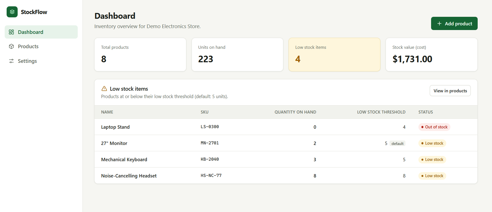
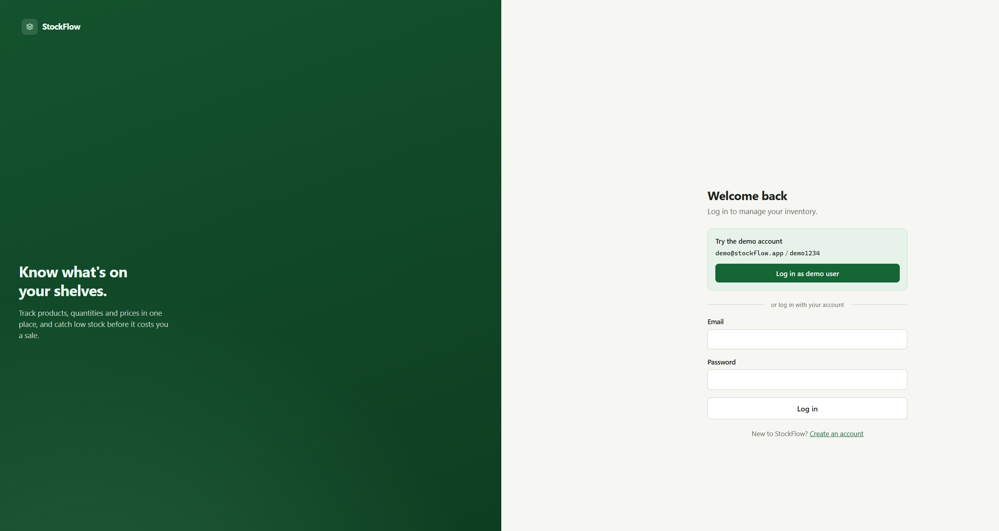
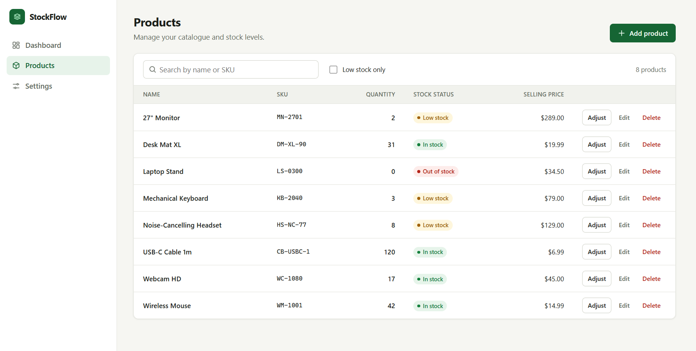
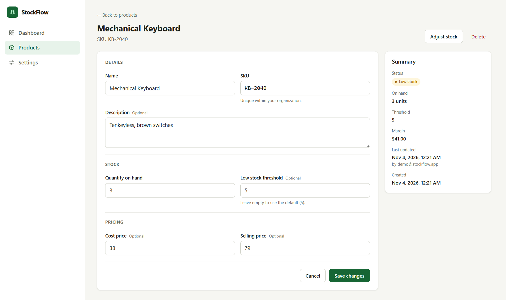

<div align="center">

# StockFlow

**A minimal multi-tenant SaaS inventory management system.**

Sign up your organization, manage products and stock levels, and catch low stock before it costs you a sale.

[](https://github.com/Raama0202/stockflow/actions/workflows/ci.yml)




</div>

## Contents

- [For evaluators — try it in 1 minute](#for-evaluators--try-it-in-1-minute)
- [Features](#features)
- [PRD success criteria](#prd-success-criteria)
- [Screenshots](#screenshots)
- [Tech stack & architecture](#tech-stack--architecture)
- [Running locally](#running-locally)
- [Testing](#testing)
- [API reference](#api-reference)
- [Configuration](#configuration)
- [Deployment](#deployment)
- [Design decisions](#design-decisions)
- [Scope & next steps](#scope--next-steps)

## For evaluators — try it in 1 minute

**On Windows:** install [Node.js 22.13+](https://nodejs.org), then double-click **`run.bat`**. It installs dependencies, builds the app, starts the server, and opens the browser for you.

**On any OS:**

```bash
git clone https://github.com/Raama0202/stockflow.git
cd stockflow
npm install
npm run build
npm start            # → http://localhost:3000
```

**Logging in:** click **Log in as demo user** on the login page. No typing needed. Or use:

| Email                | Password   |
| -------------------- | ---------- |
| `demo@stockflow.app` | `demo1234` |

The demo organization ("Demo Electronics Store") comes with 8 products, 4 of them low on stock. To test the full flow, click **Create an account** and sign up a new organization; it starts empty and is completely isolated from the demo data.

## Features

| PRD  | Feature              | What's implemented                                                                                                                                      |
| ---- | -------------------- | ------------------------------------------------------------------------------------------------------------------------------------------------------- |
| FR-1 | Signup & login       | Email, password, confirm password and organization name. Passwords hashed with bcrypt; JWT session in an httpOnly cookie; server-side validation with per-field errors. |
| FR-2 | Organization context | An organization is created on signup and linked to the user. Every query is filtered by the organization ID taken from the session, never from client input.         |
| FR-3 | Product model        | Name, SKU (unique per organization, case-insensitive), description, quantity on hand, cost price, selling price, optional low-stock threshold, created/updated timestamps. |
| FR-4 | Product CRUD         | Product table (name, SKU, quantity, stock status, selling price) with search by name or SKU, create/edit form with a detail summary, delete with a confirmation dialog.  |
| FR-5 | Stock updates        | Edit quantity directly, or use **Adjust stock** (+/- N units with a note). Records `last_updated_by`, the note, and a timestamp. Stock can never go below zero.          |
| FR-6 | Dashboard            | Total products, total units on hand, low-stock count, stock value at cost, and a low-stock table (name, SKU, quantity, threshold).                                     |
| FR-7 | Settings             | Organization-wide default low-stock threshold (default 5), used by any product without its own threshold.                                                              |

A product is **low stock** when `quantity_on_hand <= COALESCE(product.low_stock_threshold, organization.default_low_stock_threshold)`.

Extras beyond the PRD: "low stock only" filter, quick +/-1 and +/-10 stock buttons, out-of-stock badge, margin display, toast notifications, responsive layout, one-click demo login, and a Windows launcher.

## PRD success criteria

All §7 success criteria are met and covered by automated tests:

- [x] A new user can sign up, log in, and see a dashboard
- [x] Create a product with SKU and quantity
- [x] See that product in the list and in the dashboard summary
- [x] Products at or below their threshold appear in the low-stock section
- [x] All actions are scoped to the user's organization, with no cross-tenant data leaks (tested by trying to read, edit, adjust and delete another organization's product)
- [x] The app can be demoed end-to-end in a browser without manual database edits

## Screenshots

| Login (with one-click demo)                    | Products                                         |
| ---------------------------------------------- | ------------------------------------------------ |
|            |        |
| **Edit product + summary**                     | **Dashboard**                                    |
|  |  |

## Tech stack & architecture

| Layer    | Choice                                                                 |
| -------- | ---------------------------------------------------------------------- |
| Backend  | Node.js, Express 5                                                     |
| Database | SQLite via Node's built-in `node:sqlite`                               |
| Auth     | bcryptjs password hashing, JWT in an `httpOnly` `SameSite=Lax` cookie |
| Frontend | React 19, React Router, Vite, hand-written CSS                         |
| Tests    | `node:test` end-to-end API tests                                       |
| CI       | GitHub Actions on Ubuntu and Windows                                   |

A single Node process serves both the JSON API (`/api/*`) and the built React app, so there is one thing to run and one thing to deploy.

```
stockflow/
├── run.bat                  # One-click launcher for Windows
├── server/
│   ├── index.js             # Entry point: startup, port fallback, demo account
│   ├── app.js               # Express app: API routes + static frontend
│   ├── db.js                # SQLite schema
│   ├── auth.js              # Session cookies + requireAuth middleware
│   ├── validation.js        # Input validation with per-field errors
│   ├── seed.js              # Demo organization and sample products
│   └── routes/              # auth, products, dashboard, settings
├── client/src/
│   ├── pages/               # Login, Signup, Dashboard, Products, ProductForm, Settings
│   ├── components/          # Layout, Field, Dialog (confirm + adjust stock), StockBadge
│   ├── api.js               # fetch wrapper with typed errors
│   └── auth.jsx             # Auth context + route guards
├── tests/api.test.js        # API test suite
├── docs/screenshots/
├── render.yaml              # Render.com deployment blueprint
└── Dockerfile
```

### Data model

```
organizations (id, name, default_low_stock_threshold, created_at, updated_at)
users         (id, organization_id → organizations, email UNIQUE, password_hash, created_at)
products      (id, organization_id → organizations, name, sku, description,
               quantity_on_hand, cost_price, selling_price, low_stock_threshold,
               last_stock_note, last_updated_by → users, created_at, updated_at,
               UNIQUE (organization_id, sku))
```

## Running locally

Requires **Node.js 22.13 or newer** (for the built-in SQLite module).

| Command              | What it does                                                    |
| -------------------- | --------------------------------------------------------------- |
| `run.bat`            | Windows one-click: install, build, start, open the browser      |
| `npm install`        | Install dependencies                                            |
| `npm run build`      | Build the React app into `client/dist`                          |
| `npm start`          | Start the server on http://localhost:3000                       |
| `npm run dev`        | API with auto-reload (port 3000)                                |
| `npm run dev:client` | Vite dev server with hot reload (port 5173, proxies `/api`)     |
| `npm test`           | Run the test suite                                              |

Startup behaviour:
- The demo account is created on every start, and its password is reset to `demo1234` if it was changed, so the demo login always works.
- If StockFlow is already running, `run.bat` just opens it.
- If port 3000 is taken by another app, the server uses the next free port and prints the URL.

## Testing

```bash
npm test
```

11 end-to-end tests start the real Express app on an in-memory database and cover:

- **Auth:** signup and login, validation errors, duplicate emails (case-insensitive), wrong password, protected routes after logout
- **Demo account:** one-click login, the published credentials, password repair
- **Products:** full create/read/update/delete lifecycle, field validation, SKU unique per organization but reusable across organizations, search by name or SKU, stock adjustments that would go negative are rejected
- **Dashboard and settings:** totals, stock value, low-stock logic with per-product and default thresholds, changing the default threshold
- **Tenant isolation:** a second organization gets `404` when reading, updating, adjusting or deleting another organization's product, and sees none of its data

CI runs the suite and the production build on both Ubuntu and Windows on every push.

## API reference

All endpoints except signup, login, demo and health require the session cookie. Errors return `{ "error": string, "fields"?: { [field]: message } }`.

| Method | Path                       | Body / query                                             | Description                      |
| ------ | -------------------------- | -------------------------------------------------------- | -------------------------------- |
| POST   | `/api/auth/signup`         | `email, password, confirmPassword, organizationName`     | Create organization + user       |
| POST   | `/api/auth/login`          | `email, password`                                        | Start a session                  |
| POST   | `/api/auth/logout`         |                                                          | End the session                  |
| GET    | `/api/auth/me`             |                                                          | Current user and organization    |
| GET    | `/api/auth/demo`           |                                                          | Demo credentials (if enabled)    |
| POST   | `/api/auth/demo`           |                                                          | One-click demo login             |
| GET    | `/api/dashboard`           |                                                          | Summary totals + low-stock items |
| GET    | `/api/products`            | `?search=` name/SKU, `?lowStock=true`                    | List products                    |
| POST   | `/api/products`            | `name, sku, description?, quantityOnHand, costPrice?, sellingPrice?, lowStockThreshold?` | Create product |
| GET    | `/api/products/:id`        |                                                          | Product detail                   |
| PUT    | `/api/products/:id`        | same as create                                           | Update product                   |
| POST   | `/api/products/:id/adjust` | `delta, note?`                                           | Adjust stock by +/- N            |
| DELETE | `/api/products/:id`        |                                                          | Delete product                   |
| GET    | `/api/settings`            |                                                          | Organization settings            |
| PUT    | `/api/settings`            | `defaultLowStockThreshold`                               | Update settings                  |
| GET    | `/api/health`              |                                                          | Health check                     |

## Configuration

All variables are optional for local use. See [`.env.example`](.env.example).

| Variable       | Default                  | Purpose                                                                |
| -------------- | ------------------------ | ---------------------------------------------------------------------- |
| `PORT`         | `3000`                   | HTTP port                                                              |
| `JWT_SECRET`   | auto-generated           | Session signing key. Generated into `data/.jwt-secret` locally; **set it in production**. |
| `DATA_DIR`     | `./data`                 | Folder for the SQLite database                                         |
| `DB_PATH`      | `$DATA_DIR/stockflow.db` | Full database path (`:memory:` in tests)                               |
| `DEMO_ACCOUNT` | `on`                     | Set to `off` to disable the demo account and the demo login button    |

## Deployment

### Render (free, recommended)

1. Sign in at [render.com](https://render.com) with GitHub.
2. Choose **New → Blueprint** and select this repository. [`render.yaml`](render.yaml) sets up the build, start command, health check and a generated `JWT_SECRET`.
3. Click **Apply**. The app is live at `https://<service-name>.onrender.com` after the first build (about 2–3 minutes).

On the free tier the filesystem is temporary: the database resets when the service restarts or sleeps, and the demo account is re-created on startup. Free services also sleep after 15 minutes without traffic, so the first request can take about 30–60 seconds. Attach a persistent disk and set `DATA_DIR` to its mount path to keep data.

### Docker (Railway, Fly.io, any VPS)

```bash
docker build -t stockflow .
docker run -p 3000:3000 -e JWT_SECRET=change-me -v stockflow-data:/app/data stockflow
```

## Design decisions

- **Tenant isolation by construction.** The organization ID comes only from the verified session, and every product query includes `WHERE organization_id = ?`. A product from another organization returns `404`, not `403`, so IDs from other tenants aren't revealed.
- **Built-in SQLite.** `node:sqlite` needs no native compilation, so `npm install` works on any machine without build tools. That made a one-click Windows launcher reliable. The SQL is portable to PostgreSQL if the product grows.
- **httpOnly cookie sessions.** The token is never readable by JavaScript, and `SameSite=Lax` blocks cross-site form posts. The `Secure` flag is set automatically when served over HTTPS (`trust proxy` is enabled for hosts like Render).
- **Server-side validation as the source of truth.** The API returns per-field messages that the forms display inline, so the client and server can't drift.
- **Atomic stock adjustments.** The adjust endpoint runs a single `UPDATE … SET quantity = quantity + ? WHERE quantity + ? >= 0`, so concurrent adjustments can't push stock negative.
- **Timing-safe login.** Unknown emails are still checked against a dummy bcrypt hash, so response time doesn't reveal which accounts exist.

## Scope & next steps

Deliberately out of scope per PRD §4: multi-warehouse, variants, channel integrations, orders, purchase orders/suppliers, email notifications, CSV import, public API, roles/multi-user organizations, audit logs, billing, and password reset.

Natural next steps: a stock movement history table (the adjust endpoint is already the single write path), PostgreSQL for production, rate limiting on auth endpoints, password reset by email, and pagination for large catalogues.

## License

[MIT](LICENSE) © Raama Pullabhotla
